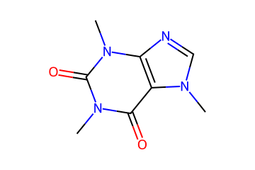
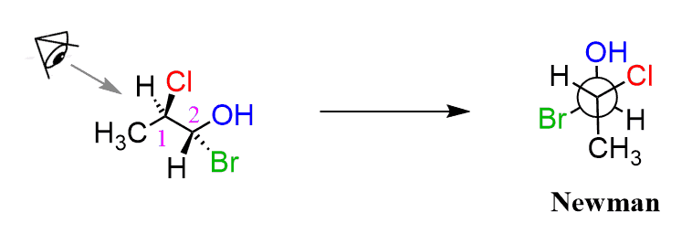
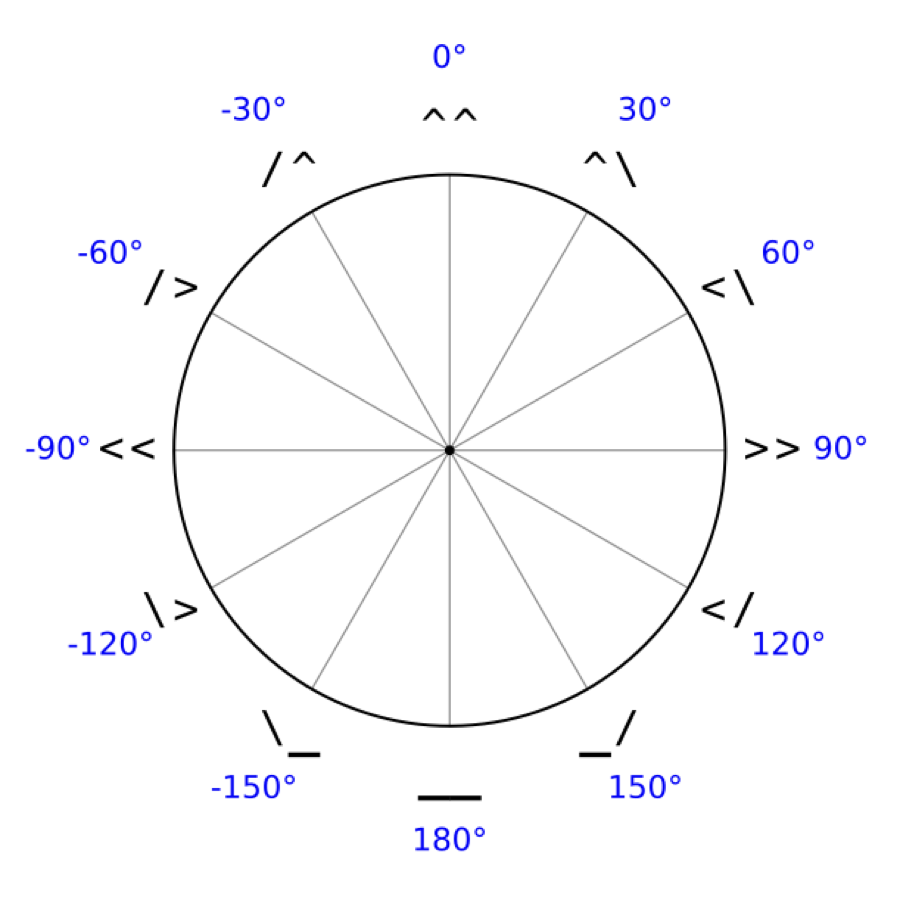
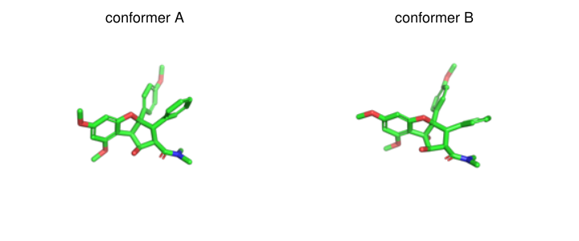
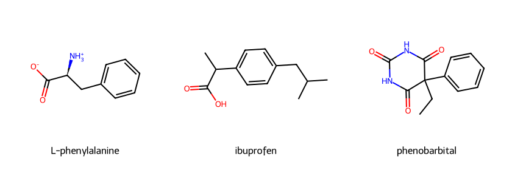

# AMSR

**A**nother **M**olecular **S**tring **R**epresentation.

AMSR is a molecular string representation designed to be fault-tolerant,
concise, and conformationally aware:

- every sequence of tokens generates a "reasonable" molecule (you may have
  different ideas about what constitutes a reasonable molecule than this
  string representation);
- common functional groups and aromatic rings can be represented by single
  tokens; and
- a 3-D conformer can be encoded by assigning a coarse-grained dihedral angle
  to each rotatable bond.

AMSR is inspired by

- [H. Hiz, "A Linearization of Chemical Graphs," *J. Chem. Doc.* **4**, 173-180 (1964)](https://pubs.acs.org/doi/10.1021/c160014a015)
- [SMILES](https://pubs.acs.org/doi/10.1021/ci00057a005)
- [PATTY](https://pubs.acs.org/doi/10.1021/ci00015a015)
- [DeepSMILES](https://github.com/baoilleach/deepsmiles)
- [SELFIES](https://github.com/aspuru-guzik-group/selfies)

## Demo and documentation

- [Interactive demo](https://amsr.harrystern.org)
- [Documentation](https://hstern2.github.io/amsr/)

## Usage

AMSR strings can be decoded directly to RDKit molecules:

```py
import amsr

caffeine = amsr.ToMol("CNcncc5cNcN6C.oC.o")
```



SMILES or RDKit molecules can be encoded in the other direction:

```py
taxol_smi = "CC1=C2[C@@]([C@]([C@H]([C@@H]3[C@]4([C@H](OC4)C[C@@H]([C@]3(C(=O)[C@@H]2OC(=O)C)C)O)OC(=O)C)OC(=O)c5ccccc5)(C[C@@H]1OC(=O)[C@H](O)[C@@H](NC(=O)c6ccccc6)c7ccccc7)O)(C)C"

amsr.FromSmiles(taxol_smi)
# CccCC`C`C`C'C`OC4.CC'C'6coC`8[OAc].C.O....[OAc].O[Bz].CC`6OcoC`O.C'N[Bz].[Ph]....O.C.C

amsr.FromSmiles(taxol_smi, useGroups=False)
# CccCC`C`C`C'C`OC4.CC'C'6coC`8OcoC..C.O....OcoC..Ococccccc6......CC`6OcoC`O.C'Ncocccccc6......cccccc6.........O.C.C
```

## Conformational representation

When `FromMol` receives an RDKit molecule with a 3-D conformer, AMSR
records the torsion around each eligible rotatable bond.  Each torsion is
rounded to the nearest 30° and written as a two-character bond token:



| angle | token | angle | token |
| ---: | :---: | ---: | :---: |
| 0° | `^^` | 180° | `__` |
| 30° | `^\` | -150° | `\_` |
| 60° | `<\` | -120° | `\>` |
| 90° | `>>` | -90° | `<<` |
| 120° | `</` | -60° | `/>` |
| 150° | `_/` | -30° | `/^` |



For example, `[Cl]C/>C[Br]` specifies a -60° Cl-C-C-Br torsion:

```py
dihedral = {}
mol = amsr.ToMol("[Cl]C/>C[Br]", dihedral=dihedral)
# dihedral == {(0, 1, 2, 3): -60}

mol_3d = amsr.GetConformer(mol, dihedral=dihedral)
```

The reference atoms for a torsion are the earliest neighboring atoms on
either side of the bond as they appear in the string.  Consecutive dihedral
tokens have an implicit carbon between them, which keeps ring conformations
compact; for example, a cyclohexane chair can be written
`C/><\/><\/><\6`.

The same 0° and 180° tokens are used for double-bond stereochemistry:
`^^` means cis or *Z*, and `__` means trans or *E*.  Whether a token
describes a rotatable-bond torsion or double-bond stereochemistry follows
from the bond order.

### Conformer round trips

A conformer can be encoded, decoded, and reconstructed as follows:

```py
from rdkit import Chem
import amsr

source = Chem.MolFromMolFile("molecule.sdf", removeHs=True)
encoded = amsr.FromMol(source)

dihedral = {}
decoded = amsr.ToMol(encoded, dihedral=dihedral)
reconstructed = amsr.GetConformer(decoded, dihedral=dihedral)
```

`GetConformer` obtains trial coordinates from distance geometry, fixes
chirality, E/Z geometry, ring puckers, and acyclic dihedrals, then optimizes
all atom positions subject to ideal bond lengths and angles, planarity,
stereochemistry, and the encoded dihedrals.  Candidates with serious
nonbonded clashes are rejected.  `amsr.Roundtrip(source)` provides the same
workflow and also returns the symmetry-aware heavy-atom RMSD to the source
conformer.

The 30° discretization is deliberately coarse-grained: it keeps the
conformational alphabet small while retaining enough geometry to reconstruct
the overall conformer.

### Rocaglamide

Rocaglamide illustrates how the topology and absolute stereochemistry can
remain fixed while the dihedral tokens distinguish conformers:



Conformer A:

    CNC.__co\>C`__C`^\C'^^C'/^C`_/5O..__(6)O\>5@.__[OMe].__[OMe]O.>>(6)..__[OMe]..\_[Ph]

Conformer B:

    CNC.__co<<C`\_C`^^C'^\C'/^C`_/5O.._/(6)O\_5@.^^[OMe].__[OMe]O./>(6)..^^[OMe]..<\[Ph]

Both strings decode to rocaglamide.  Their different two-character bond
tokens retain the two arrangements shown above.

## Groups

Groups are token-level abbreviations.  They make strings shorter without
introducing a second decoding mechanism: each group is expanded to ordinary
AMSR atom and bond tokens before the molecule is constructed.  `FromMol`
and `FromSmiles` use groups by default; pass `useGroups=False` to obtain the
fully expanded string.

### Conventional abbreviations

Bracketed groups cover common substituents and functional groups:

| family | tokens |
| --- | --- |
| aryl and cyclic | `[Ph]`, `[Tol]`, `[Bn]`, `[Bz]`, `[Cy]` |
| alkyl | `[Et]`, `[nPr]`, `[iPr]`, `[nBu]`, `[sBu]`, `[iBu]`, `[tBu]`, `[nPent]` through `[nDec]` |
| oxygen and carbonyl | `[OMe]`, `[OEt]`, `[OiBu]`, `[Ac]`, `[OAc]`, `[CHO]`, `[COOH]`, `[COO-]`, `[COOMe]`, `[COOEt]`, `[Piv]` |
| nitrogen and sulfur | `[NHMe]`, `[NMe2]`, `[NHAc]`, `[SMe]`, `[Ms]`, `[Ts]`, `[Tf]`, `[SO3]` |
| protecting and other groups | `[Boc]`, `[Cbz]`, `[CN]`, `[NC]`, `[NO2]`, `[CF3]`, `[CCl3]`, `[PO3]` |

| AMSR | molecule |
| --- | --- |
| `N+C'[Bn][COO-]` | [L-phenylalanine](https://en.wikipedia.org/wiki/Phenylalanine) |
| `cccccc6[iBu]..CC.[COOH]` | [ibuprofen](https://en.wikipedia.org/wiki/Ibuprofen) |
| `C[Ph][Et]coNcoNco6` | [phenobarbital](https://en.wikipedia.org/wiki/Phenobarbital) |



### Aromatic-ring groups

Parenthesized tokens encode an entire monocyclic aromatic ring.  The number
is the ring size; letters `a` through `f` are positions in string traversal
order; and the element after a position replaces the carbon at that position.
For six-membered rings, `N` indicates one or more pyridine-like nitrogens.
Unlike `[Ph]`, which is a capped phenyl substituent, `(6)` leaves the ring's
remaining valences available as the string continues.

| token | expansion | ring |
| --- | --- | --- |
| `(6)` | `cccccc6` | benzene |
| `(6aN)` | `nccccc6` | pyridine |
| `(6acN)` | `ncnccc6` | pyrimidine |
| `(5aO)` | `Occcc5` | furan |
| `(5aNbN)` | `nNccc5` | pyrazole |

The position letters describe the AMSR traversal, not conventional ring
numbering.  All supported five- and six-membered aromatic patterns are
generated by `amsr/aromatics.py` and are available through `amsr.Groups()`.

### Inspecting and extending groups

`amsr.Groups()` returns the live group dictionary.  Its keys are group
tokens, and each value is a list of one or more equivalent AMSR expansions.
The decoder uses the first expansion; the encoder recognizes all of them.

```py
groups = amsr.Groups()
groups["[Ph]"]
# ["cccccc6....."]

groups["[PEG2]"] = ["OCCOCC...."]
amsr.InitializeGroups()

amsr.FromSmiles("COCCOCC")
# "C[PEG2]"
```

Call `InitializeGroups()` after modifying the dictionary so the encoder and
decoder rebuild their lookup structures.

## Language reference

### Atoms

Atoms are represented by their symbol enclosed in square brackets, as in
SMILES.  For a one-letter symbol, brackets may be omitted.  Atoms are assumed
to have a fixed valence that limits the number of covalently-bonded neighbors.
If an atom makes fewer bonds than its valence, hydrogens are assumed.

| AMSR | molecule |
| --- | --- |
| `C` | [methane](https://en.wikipedia.org/wiki/Methane) |
| `O` | [water](https://en.wikipedia.org/wiki/Water) |
| `[Cl]` | [hydrochloric acid](https://en.wikipedia.org/wiki/Hydrochloric_acid) |

### Chains

Each atom in a chain is bonded to the most recently added atom that can still
make bonds, according to its valence.  Hydrogens may be added explicitly like
any other atom.  In the example below, the fluorines are added to the second
carbon; the chlorine is then added to the first carbon, since the second can
no longer bond.

| AMSR | molecule |
| --- | --- |
| `CCFFF[Cl]` | [2-chloro-1,1,1-trifluoroethane](https://pubchem.ncbi.nlm.nih.gov/compound/2-Chloro-1_1_1-trifluoroethane) |

### Branches

Branches are formed automatically when atoms can no longer make bonds.  They
can also be made by "capping" or "saturating" an atom with hydrogens, using a
period `.`.  Capping hydrogens are applied to the most recently added atom
that can still make bonds.  New atoms will then be bonded to those added
earlier, forming a branch.

| AMSR | molecule |
| --- | --- |
| `CCC.C` | [isobutane](https://en.wikipedia.org/wiki/Isobutane) |
| `CC.CC.C.C` | [2,2-dimethylbutane](https://pubchem.ncbi.nlm.nih.gov/compound/6403) |

### Rings

Rings are denoted by a single digit, or two or more digits enclosed in square
brackets, giving the size of the ring.  A new bond is formed between the two
most recently added atoms that can make bonds and, when bonded, will form a
ring of that size.

| AMSR | molecule |
| --- | --- |
| `CCO3` | [oxirane](https://en.wikipedia.org/wiki/Ethylene_oxide) |
| `CCCCCC6` | [cyclohexane](https://en.wikipedia.org/wiki/Cyclohexane) |
| `CCCCCCCCCCCC[12]` | [cyclododecane](https://en.wikipedia.org/wiki/Cyclododecane) |

When more than one ring of a given size can be formed, one or more `@` signs
immediately after the digit make ring-forming bonds with atoms appearing
earlier in the string, rather than the most recent.

| AMSR | molecule |
| --- | --- |
| `ccOcc5cccc6` | [benzofuran](https://en.wikipedia.org/wiki/Benzofuran) |
| `ccOcc5cccc6@` | [isobenzofuran](https://en.wikipedia.org/wiki/Isobenzofuran) |

### Double bonds (sp<sup>2</sup> centers)

Atoms making a double bond are indicated by changing the symbol to lowercase
(note that lowercase does not mean "aromatic"; merely, "atom having one fewer
neighbor than its valence").  Double bonds are assigned by a matching
algorithm.  If a perfect matching cannot be found, for instance in the case
of an odd number of contiguous lowercase symbols, a maximal matching is
chosen, non-matched atoms remain singly bonded, and hydrogens are added.

| AMSR | molecule |
| --- | --- |
| `co` | [formaldehyde](https://en.wikipedia.org/wiki/Formaldehyde) |
| `cccccc6` | [benzene](https://en.wikipedia.org/wiki/Benzene) |
| `cco` | [acetaldehyde](https://en.wikipedia.org/wiki/Acetaldehyde) (only one double bond added) |

An oxygen with two neighbors or a nitrogen with three in an aromatic ring is
still denoted by a capital, not a lowercase, symbol.  Although
sp<sup>2</sup>-hybridized, its coordination number is still equal to its
valence.

| AMSR | molecule |
| --- | --- |
| `ccccO5` | [furan](https://en.wikipedia.org/wiki/Furan) |
| `ccccN5` | [pyrrole](https://en.wikipedia.org/wiki/Pyrrole) |

### Triple bonds (sp centers)

Atoms with two fewer neighbors than their valence are designated by a
trailing colon `:` and can make triple bonds or more than one double bond.

| AMSR | molecule |
| --- | --- |
| `C:N:` | [hydrogen cyanide](https://en.wikipedia.org/wiki/Hydrogen_cyanide) |
| `oC:o` | [carbon dioxide](https://en.wikipedia.org/wiki/Carbon_dioxide) |

### Hypervalent atoms

Atoms denoted by their symbol alone are assumed to have their lowest possible
valence (for instance, two for sulfur).  Higher valences are denoted by one or
more exclamation points `!`.

| AMSR | molecule |
| --- | --- |
| `CSC` | [dimethyl sulfide](https://en.wikipedia.org/wiki/Dimethyl_sulfide) |
| `Cs!oC` | [dimethyl sulfoxide](https://en.wikipedia.org/wiki/Dimethyl_sulfoxide) |
| `S!!FFFFFF` | [sulfur hexafluoride](https://en.wikipedia.org/wiki/Sulfur_hexafluoride) |

### Formal charges, radical electrons, and isotopes

Positive and negative formal charges are designated by one or more `+` or
`-` signs.  Radical electrons are denoted by one or more asterisks `*`.
An isotopic mass is denoted by a number prefix before the atomic symbol, in
which case square brackets must be used even for a one-letter symbol.

| AMSR | molecule |
| --- | --- |
| `[Mg++];S!!:ooO-O-` | [magnesium sulfate](https://en.wikipedia.org/wiki/Magnesium_sulfate) |
| `CC.C.CCCCC.C.N6O*` | [(2,2,6,6-Tetramethylpiperidin-1-yl)oxyl or TEMPO](https://en.wikipedia.org/wiki/TEMPO) |
| `[2H]O[2H]` | [heavy water](https://en.wikipedia.org/wiki/Heavy_water) |

### Tetrahedral stereochemistry

Tetrahedral stereochemistry is denoted by a single quote `'` meaning
"clockwise" or a backtick character <code>&#96;</code> meaning
"counterclockwise."  The direction refers to the first three neighbors of a
stereocenter as they appear in the string, with the last neighbor or implicit
hydrogen in back.

| AMSR | molecule |
| --- | --- |
| <code>C`C.FO</code> | [(1*S*)-1-fluoroethanol](https://pubchem.ncbi.nlm.nih.gov/compound/57518764) |
| `C'C.FO` | [(1*R*)-1-fluoroethanol](https://pubchem.ncbi.nlm.nih.gov/compound/60205193) |

### *E/Z* stereochemistry

As described above, double-bond stereochemistry is denoted by `__` meaning
"trans" or *E*, or `^^` meaning "cis" or *Z*.  The reference neighboring
atoms are those that appear earliest in the string.

| AMSR | molecule |
| --- | --- |
| `c[Br][Cl]__c[Cl]` | [(*E*)-1-bromo-1,2-dichloroethene](https://pubchem.ncbi.nlm.nih.gov/compound/E_-1-Bromo-1_2-dichloroethene) |
| `c[Br][Cl]^^c[Cl]` | [(*Z*)-1-bromo-1,2-dichloroethene](https://pubchem.ncbi.nlm.nih.gov/compound/Z_-1-Bromo-1_2-dichloroethene) |

### Multiple molecules

More than one molecule may be specified by separating them with `;`.

| AMSR | molecule |
| --- | --- |
| `ocC.O(6)[COOH];CcoN(6)..O` | [aspirin](https://en.wikipedia.org/wiki/Aspirin) and [acetaminophen](https://en.wikipedia.org/wiki/Paracetamol) |

## Developing

See [INSTALL.md](https://github.com/hstern2/amsr/blob/main/INSTALL.md) for the
complete setup and test instructions.

```bash
uv sync --extra dev
make
uv run --extra dev pytest
```
